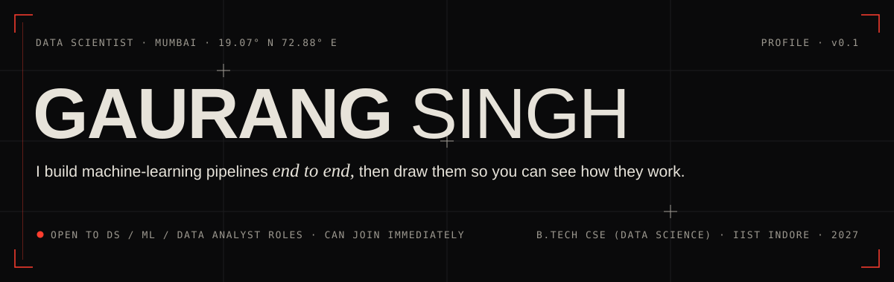

<picture>
  <source media="(prefers-color-scheme: dark)" srcset="./assets/header-dark.svg">
  <source media="(prefers-color-scheme: light)" srcset="./assets/header-light.svg">
  
</picture>

  
  
  
  

 

<picture>
  <source media="(prefers-color-scheme: dark)" srcset="./assets/pipeline-dark.svg">
  <source media="(prefers-color-scheme: light)" srcset="./assets/pipeline-light.svg">
  
</picture>

## `02 /` Selected work

<!-- TODO: link each project name to its repo once they're public -->

| | Project | What it is | Signal |
|:--|:--|:--|--:|
| `01` | **StressSense** Android · on-device ML · in progress | Stress detection that runs on the phone. A gradient-boosting teacher (93.5%) distilled into an INT8 TensorFlow Lite student that keeps 91.2% accuracy. Kotlin + Jetpack Compose. | **5.77 KB** model · &lt;1.8 ms/pred |
| `02` | **Ensemble on 70K patient records** Published · ACET 2025 | Random Forest + MLP ensemble, taken from raw records through cleaning, training and peer review. | **94.80%** accuracy |
| `03` | **Predictive automation at Fixo** AI/ML intern · IIT Madras · Aug–Nov 2025 | Built and deployed TensorFlow / scikit-learn models for predictive analytics, taking manual work off the team. | **−75%** manual processing time |
| `04` | **UPI fraud detection** Imbalanced learning · evaluation | 250K heavily imbalanced transactions. Careful evaluation showed the features carried weak fraud signal — and I reported that plainly instead of dressing up the numbers. | **250K** transactions analysed |

## `03 /` Stack

<table>
  <tr>
    <td><code>MODEL</code></td>
    <td>
      
      
      
      
      
    </td>
  </tr>
  <tr>
    <td><code>DATA</code></td>
    <td>
      
      
      
      
      
      
      
    </td>
  </tr>
  <tr>
    <td><code>SHIP</code></td>
    <td>
      
      
      
      
      
      
    </td>
  </tr>
  <tr>
    <td><code>MAKE</code></td>
    <td>Motion graphics · video · brand identity · UI design</td>
  </tr>
</table>

## `04 /` About

Final-year **B.Tech CSE (Data Science)** at IIST Indore, graduating 2027. Alongside the degree I co-founded a motion and design studio — which is why my models come with diagrams.

- **Monky Studio** · Co-founder · 2024–2026 — 100+ projects for 20+ clients: video, motion, brand, UI.
- **Paradox, IIT Madras** · Video editor & graphics · 2023–2025 — 50+ visual assets on 48-hour turnarounds.

## `05 /` Serve

> The pipeline ends with a hire. Open to **data scientist, ML engineer and data analyst** roles in Mumbai / Navi Mumbai or remote — can join immediately.
>
> **[gaurangsingh532@gmail.com](mailto:gaurangsingh532@gmail.com)** · [LinkedIn](https://linkedin.com/in/-gaurangsingh). 
[portfolio](https://www.gaurang.studio/)